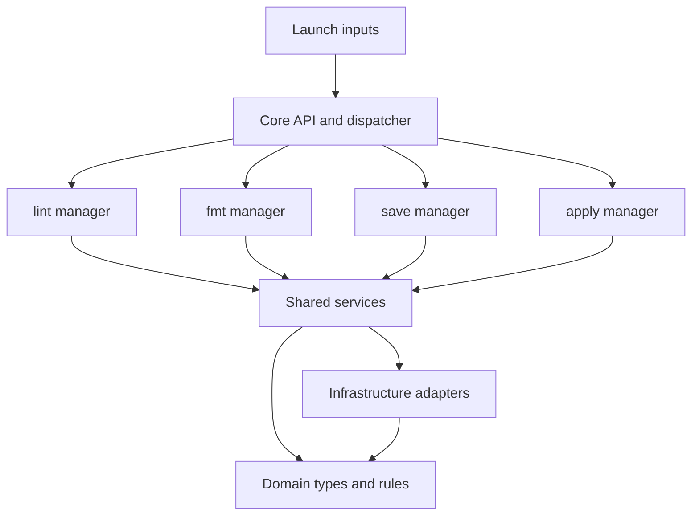

# Architecture contract

Status: accepted. This document defines constraints, not suggested conventions.
Read it before changing application structure. Changes to this contract require
an explicit architecture discussion and a separate reviewed change.

## Package targets and launch inputs

One Cargo package, `lyfy`, contains two targets with the same name:

- The `lyfy` library owns all system maintenance logic.
- The `lyfy` executable owns its launch inputs.

`src/bin/lyfy/main.rs` is a small bootstrap: parse an input, resolve launch
settings, construct a context, invoke the library, display returned data and
choose the exit code. It contains no system maintenance logic.

`src/bin/lyfy/inputs/` owns CLI arguments, environment variables, XDG discovery,
TOML reading, precedence and launch presentation preferences. `format` and
`config_file` belong here. The library never reads these sources. Its modules
cannot import input code: inputs are compiled only into the binary target.

clap and TOML are optional dependencies behind the `cli` feature, enabled by
default for normal executable builds. `cargo build --lib --no-default-features`
builds the library without input libraries. A future input adapts to the same
library API; it does not become a new layer inside the library.

There is no output layer, transport layer, server, RPC protocol or event bus.
Results remain ordinary return values. An optional synchronous, per-call
inspection observer exposes check timing, findings and coverage to the caller.
It cannot dispatch commands. Rendering feedback in the executable does not
create an application subsystem; the library never renders or elevates.

## Exactly four commands

The public `lyfy::Request` enum and the CLI each contain exactly:

1. `lint`: inspect the current system against the Arch policy.
2. `fmt`: plan or execute supported deterministic policy fixes.
3. `save`: capture concrete system state for the selected host.
4. `apply`: plan or execute reconciliation with a saved host snapshot.

A command is an operation, not a boolean setting, configuration key, flag,
plugin name or dynamically registered handler. The `--write` flag grants
execution permission to an existing fmt/apply request. It cannot be enabled
by configuration or environment variables. Lint's sudo policy is owned by
inputs: `--elevate=auto` is the default, requesting authentication when stdin
and stderr are terminals and the target root is `/`. Bare `--elevate` requires
sudo regardless of those conditions; `--elevate=never` disables the request.
The child runs only read-only lint with the caller's resolved settings and
`--elevate=never`. The policy has no configuration key or ENV override; the
library never decides to elevate or invokes authentication itself.
Adding a fifth command requires
a discussion; helper code must not become an extra command implicitly.

## Library layers

The library contains exactly four layer directories beside the separate `bin/` target. They have these responsibilities:

| Layer | Owns | May depend on |
| --- | --- | --- |
| `domain` | Validated settings, state types, rule definitions, plans, results, pure comparison rules | Domain and pure libraries |
| `managers` | The sequence and execution policy of each command | Domain and services |
| `services` | Reusable application capabilities | Domain, infrastructure, acyclic service dependencies |
| `infrastructure` | Filesystem descriptors, persistence, process execution, pacman integration | Domain and infrastructure |

`lib.rs` composes the context and dispatches requests to managers. It is the
only module allowed to reference the managers as a group. Managers are private
implementation details; the stable entry points are `Context`, `Request` and
`execute` (or `execute_observed` for inspection feedback), with typed result data.

## Manager boundaries

There are exactly four flat manager modules: `lint.rs`, `fmt.rs`, `save.rs`,
`apply.rs`. Their `mod.rs` only declares modules.

- Managers never import or call other managers, including indirectly through
  a callback, dispatcher, service or alias. A manager must not invoke `execute`.
- Managers do not read files, spawn processes, parse inputs, inspect ENV or
  render terminal text. They coordinate named capabilities.
- A service never calls a manager or the dispatcher. Infrastructure never
  calls a service or manager. Domain code has no OS access.
- Public functions take explicit inputs and return typed values or errors.
  No global mutable context, ambient launch-setting dependencies or hidden
  execution permission.

For example, fmt and apply share the `transactions` service. fmt does not call
the apply manager. Likewise lint and fmt share `inspection`; fmt does not run
the lint command.

## Shared capabilities

| Service | Responsibility |
| --- | --- |
| `inspection` | Run the Arch catalog and return findings and skipped checks |
| `remediation` | Convert automatically fixable findings to file changes |
| `files` | Observe a concrete target node with bounded content reads |
| `capture` | Walk managed scopes, verify observations and store content objects |
| `snapshots` | Resolve pinned bases, read prior history and commit host snapshots through the configured store |
| `reconciliation` | Build a three-way file plan and a package comparison |
| `transactions` | Preflight, back up preimages, write files, journal and record receipts |
| `packages` | Expose inventory capture and supported package restoration |
| `session` | Hold repository and state locks for mutating operations |

Services are capabilities, not a collection of functions called `utils`,
`helpers`, `common`, `base` or `manager`. New shared logic goes into the
capability that owns the invariant. Add a new narrowly named capability only
when its responsibility cannot be expressed by an existing one.

Infrastructure has five adapters: `filesystem`, `store`, `git`, `process`, `pacman`.
They implement mechanisms. Policy decisions belong to domain or services.
The pacman adapter reads state through dynamically linked libalpm and libarchive.
Only infrastructure may import their Rust bindings or contain their FFI calls.
It returns owned domain data: packages, database issues and expected file
metadata. Inspection services compare observations and select rules. Package
findings expose typed file evidence rather than parsed CLI diagnostics.
The only remaining pacman subprocess is the interactive package restoration
transaction in `pacman/restore.rs`; inventory and inspection never invoke it.
Read-only opens must reject missing local databases/version markers before
initializing libalpm, which otherwise creates them. Never start a transaction
or update a repository while inspecting. Apply/save exclude the configured
DBPath from file state, including when package checks are disabled.
Do not add a trait and implementation pair for every concrete operation.
Introduce an interface when a second implementation or a real testing need
requires it, while preserving the dependency direction.

## Rule and inspection contract

The closed, typed rule catalog belongs to domain. Each rule has one stable ID,
a semantic revision, severity, category, subject kind, explanation, remedy and
an optional supported fix kind. IDs are never reused for another meaning.
Behavior changes update the revision; removals require a documented migration.
Categories distinguish integrity, maintenance, observations and lyfy policy.
The UKI requirement is lyfy policy, not a claim about Arch requirements.

Inspection services implement checks over shared observations. A check can
evaluate several rules without repeating a database open or filesystem walk.
Checks have typed identities and recorded outcomes, durations and finding
counts. Disabling a check, an inapplicable runtime check and an incomplete
check are different states. Completion means observations were collected;
it does not mean no rule was violated. An observer receives synchronous
typed events and cannot select rules or alter execution policy.

Findings describe observed system state. Access errors, unsupported data and
failed prerequisites are separate coverage diagnostics, never system rules.
Incomplete coverage returns exit code 2, outstanding findings at or above the
configured fail_on threshold return 1, and a complete successful scan returns
0. Disabled rules and a severity threshold are explicit validated core inputs;
the launch input supplies their flag/ENV/TOML overrides.

Automatic remediation is a closed enum of concrete actions. A finding may
offer only an action supported by its rule. The remediation service matches
that action, revalidates scope and preimages, and uses normal transactions.
Successful execution is verified before findings are marked fixed. Unknown
actions cannot fall through to a default file mutation. fmt and lint share
inspection and domain contracts and never call one another.

The input owns terminal capability detection, progress rendering, report
formats and file destinations. Text, JSON, TOML, YAML, Markdown and SARIF are
representations of the same returned report. Structured reports include a
schema version and rule metadata. Export uses atomic private files and refuses
to replace an existing destination. An elevated scan returns data to the
original caller; the caller renders and saves the report with its privileges.
No formatter, terminal library or report-file writer enters the core.

Adding a rule requires a catalog entry, a check implementation, fixture tests
for positive/negative and incomplete observations, and a catalog document
update. Adding a fix also requires precondition, conflict and postcondition
tests. Contract tests enforce catalog identities, check ownership and action
compatibility. Presentation tests consume the public report contract, rather
than reaching into inspection implementations.

## State invariants

- Stored state is concrete file content and metadata, never generated templates.
- Home paths use the `home/` namespace; system paths use `system/`.
- A host snapshot is an overlay over an optional immutable, pinned base.
- Editing a deployed file and saving creates a new host snapshot. It does not
  silently edit the common base or another host's state.
- Git is the default storage format: concrete payload files and JSON metadata,
  with Git revisions as snapshot identities. Ordinary commits and clones carry
  all host state, including pinned common bases.
- The optional directory backend uses content hashes and immutable manifests.
- Reconciliation reads a selected committed revision, never uncommitted edits.
- Save refuses a dirty Git repository and never pushes or merges implicitly.
- The context owns one explicit repository session shared by named services;
  managers cannot access its persistence implementation directly.
- Exclusions apply to capture and reconciliation, including imported snapshots.
- File execution uses backups, an explicit plan and a transaction journal.
- Package transactions have separate semantics and are not filesystem rollback.

## Enforcement

Run `python3 scripts/check-architecture.py`. CI requires this check. It verifies
the manager and layer sets, explicit dependency paths, absence of input and
terminal code in the core, and acyclic service dependencies. Source checks
complement Rust module visibility and Cargo target boundaries.

The CLI tests verify that the operation set contains exactly four commands and
each setting has its snake_case flag and LYFY environment override. A core API
test exercises save/apply without the executable, ENV or a configuration file.

Any exception must update this contract and its checks in the same reviewed
architecture change. Do not bypass a check to complete a feature.
