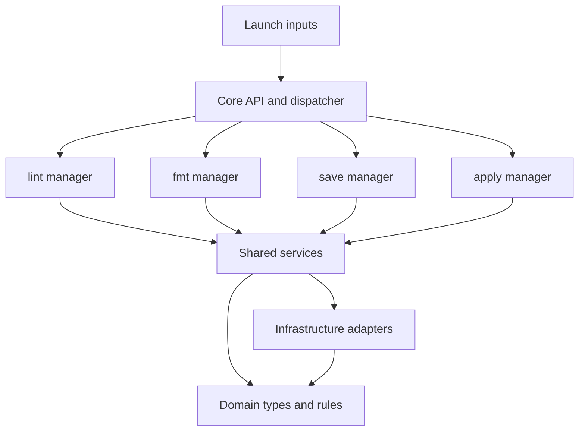

# Architecture contract

Status: accepted. This document defines constraints, not suggested conventions.
Read it before changing application structure. Changes to this contract require
an explicit architecture discussion and a separate reviewed change.

## Package targets and launch inputs

One Cargo package, `lyfy`, contains two targets with the same name:

- The `lyfy` library owns all system maintenance logic.
- The `lyfy` executable owns its launch inputs.

`src/bin/lyfy/main.rs` is a small bootstrap: parse an input, resolve launch
settings, construct a context, invoke the library, display returned data and
choose the exit code. It contains no system maintenance logic.

`src/bin/lyfy/inputs/` owns CLI arguments, environment variables, XDG discovery,
TOML reading, precedence and launch presentation preferences. `format` and
`config_file` belong here. The library never reads these sources. Its modules
cannot import input code: inputs are compiled only into the binary target.

clap and TOML are optional dependencies behind the `cli` feature, enabled by
default for normal executable builds. `cargo build --lib --no-default-features`
builds the library without input libraries. A future input adapts to the same
library API; it does not become a new layer inside the library.

There is no output layer, transport layer, server, RPC protocol or event bus.
Ordinary return values are sufficient for the calling program. Rendering a
result in the executable does not create an application subsystem.

## Exactly four commands

The public `lyfy::Request` enum and the CLI each contain exactly:

1. `lint`: inspect the current system against the Arch policy.
2. `fmt`: plan or execute supported deterministic policy fixes.
3. `save`: capture concrete system state for the selected host.
4. `apply`: plan or execute reconciliation with a saved host snapshot.

A command is an operation, not a boolean setting, configuration key, flag,
plugin name or dynamically registered handler. The `--write` flag grants
execution permission to an existing fmt/apply request. It cannot be enabled
by configuration or environment variables. Adding a fifth command requires
a discussion; helper code must not become an extra command implicitly.

## Library layers

The library contains exactly four layer directories beside the separate `bin/` target. They have these responsibilities:

| Layer | Owns | May depend on |
| --- | --- | --- |
| `domain` | Validated settings, state types, rule definitions, plans, results, pure comparison rules | Domain and pure libraries |
| `managers` | The sequence and execution policy of each command | Domain and services |
| `services` | Reusable application capabilities | Domain, infrastructure, acyclic service dependencies |
| `infrastructure` | Filesystem descriptors, persistence, process execution, pacman integration | Domain and infrastructure |

`lib.rs` composes the context and dispatches requests to managers. It is the
only module allowed to reference the managers as a group. Managers are private
implementation details; the stable entry points are `Context`, `Request` and
`execute`, with typed result data.

## Manager boundaries

There are exactly four flat manager modules: `lint.rs`, `fmt.rs`, `save.rs`,
`apply.rs`. Their `mod.rs` only declares modules.

- Managers never import or call other managers, including indirectly through
  a callback, dispatcher, service or alias. A manager must not invoke `execute`.
- Managers do not read files, spawn processes, parse inputs, inspect ENV or
  render terminal text. They coordinate named capabilities.
- A service never calls a manager or the dispatcher. Infrastructure never
  calls a service or manager. Domain code has no OS access.
- Public functions take explicit inputs and return typed values or errors.
  No global mutable context, ambient launch-setting dependencies or hidden
  execution permission.

For example, fmt and apply share the `transactions` service. fmt does not call
the apply manager. Likewise lint and fmt share `inspection`; fmt does not run
the lint command.

## Shared capabilities

| Service | Responsibility |
| --- | --- |
| `inspection` | Run the Arch catalog and return findings and skipped checks |
| `remediation` | Convert automatically fixable findings to file changes |
| `files` | Observe a concrete target node with bounded content reads |
| `capture` | Walk managed scopes, verify observations and store content objects |
| `snapshots` | Resolve pinned bases, read prior history and commit host snapshots through the configured store |
| `reconciliation` | Build a three-way file plan and a package comparison |
| `transactions` | Preflight, back up preimages, write files, journal and record receipts |
| `packages` | Expose inventory capture and supported package restoration |
| `session` | Hold repository and state locks for mutating operations |

Services are capabilities, not a collection of functions called `utils`,
`helpers`, `common`, `base` or `manager`. New shared logic goes into the
capability that owns the invariant. Add a new narrowly named capability only
when its responsibility cannot be expressed by an existing one.

Infrastructure has five adapters: `filesystem`, `store`, `git`, `process`, `pacman`.
They implement mechanisms. Policy decisions belong to domain or services.
Do not add a trait and implementation pair for every concrete operation.
Introduce an interface when a second implementation or a real testing need
requires it, while preserving the dependency direction.

## State invariants

- Stored state is concrete file content and metadata, never generated templates.
- Home paths use the `home/` namespace; system paths use `system/`.
- A host snapshot is an overlay over an optional immutable, pinned base.
- Editing a deployed file and saving creates a new host snapshot. It does not
  silently edit the common base or another host's state.
- Git is the default storage format: concrete payload files and JSON metadata,
  with Git revisions as snapshot identities. Ordinary commits and clones carry
  all host state, including pinned common bases.
- The optional directory backend uses content hashes and immutable manifests.
- Reconciliation reads a selected committed revision, never uncommitted edits.
- Save refuses a dirty Git repository and never pushes or merges implicitly.
- The context owns one explicit repository session shared by named services;
  managers cannot access its persistence implementation directly.
- Exclusions apply to capture and reconciliation, including imported snapshots.
- File execution uses backups, an explicit plan and a transaction journal.
- Package transactions have separate semantics and are not filesystem rollback.

## Enforcement

Run `python3 scripts/check-architecture.py`. CI requires this check. It verifies
the manager and layer sets, explicit dependency paths, absence of input and
terminal code in the core, and acyclic service dependencies. Source checks
complement Rust module visibility and Cargo target boundaries.

The CLI tests verify that the operation set contains exactly four commands and
each setting has its snake_case flag and LYFY environment override. A core API
test exercises save/apply without the executable, ENV or a configuration file.

Any exception must update this contract and its checks in the same reviewed
architecture change. Do not bypass a check to complete a feature.
