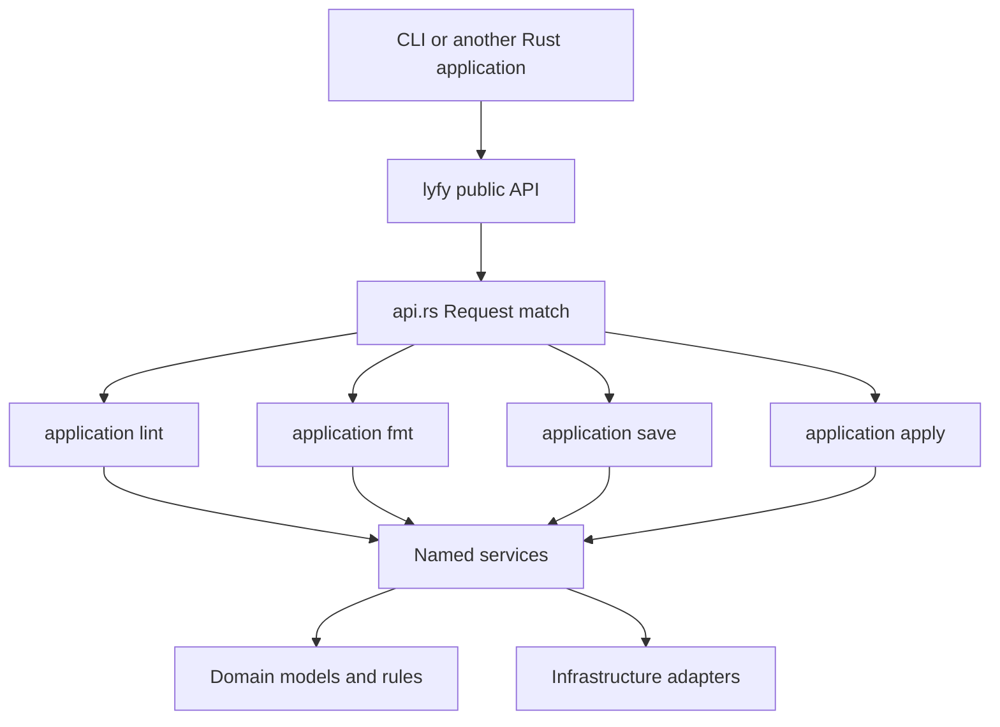

# Application operations and public Rust API

The core has four internal layers: application, domain, services and
infrastructure. There are exactly four application operations: lint, fmt, save
and apply. Each is a flat module containing one crate-internal run function.
Operations never import or call one another; they coordinate named services.

## Source layout

```text
crates/lyfy/src/
  lib.rs                  # Public facade: private modules and explicit exports
  api.rs                  # Context, requests, results and dispatch
  application/
    mod.rs                # Only the four module declarations
    lint.rs
    fmt.rs
    save.rs
    apply.rs
  domain/                 # Models, policies, validation and comparisons
  services/               # Shared application capabilities
  infrastructure/         # Filesystem, storage, Git, process and pacman adapters
```

lib.rs exposes selected API/model names at the crate root. It does not contain
operation implementation or publicly expose internal layer paths. api.rs is the
only composition root: it constructs resources and dispatches a Request to the
corresponding operation. The implementation has no handler registry, trait/class
per operation, plugin command discovery or extra command through a helper.



## Execution contract

Context::new takes typed Config, validates it and prepares the repository
resource. It does not discover/read application TOML, parse CLI/ENV or choose
user launch defaults. Those belong to lyfy-cli; see library.md.

execute delegates to execute_observed with a no-op observer. An exhaustive
Request match selects one operation. The observer supplies synchronous inspection
and capture feedback; explicit capture_only requests use private archive chunks.
The observer cannot dispatch another command. Internal
operations return concrete result types which the API wraps in Data/Outcome.

| Operation | Coordination | Concrete result |
| --- | --- | --- |
| lint | Inspect selected Arch checks and return findings/coverage | Report |
| fmt | Lock when writing, inspect/plan, optionally execute and verify | Formatted |
| save | Route scopes, preview or capture overlays/inventory, publish and replicate | Saved |
| apply | Select managed/data scopes or an archive, reconcile and optionally execute | Applied |

run is an ordinary function name. It is meaningful in its operation module and
has no special Rust entry-point behavior. The common name does not require a
common signature: lint accepts feedback, fmt/apply receive explicit execution
permission, and each returns its own typed data. Rust visibility is explicit:
all four run functions are pub(crate), and their modules remain private externally.

CLI input, formatting and elevation do not enter this layer. The application
operation chooses sequence and execution policy; a service owns reusable logic;
an infrastructure adapter implements I/O. Existing transaction preconditions,
backups, journals and postcondition checks continue to apply.

## Public surface and compatibility

Consumers import Config, Context, Request, Data, Outcome, execute and
execute_observed from lyfy. Report/plan/policy/result types used by those contracts
are explicitly exported there too, for example Report, RuleId, Observation and
Plan. Domain layout, persistence manifests, expected native package metadata and
backend implementation types are private.

This narrows a previously broad public namespace. Update imports such as:

```rust
// Before: use lyfy::domain::diagnostics::Report;
use lyfy::Report;
```

Context/Config and operation behavior remain available. The old lyfy::domain
module path is no longer public. Storage now supports nested VFS scopes and
schema 2 metadata; schema 1 remains readable. See save.md for archive migration
and execution behavior.

The contract is a Rust source API, not a stable binary ABI. pub controls source
visibility; it does not establish an independently replaceable liblyfy.so ABI.
[Visibility](https://doc.rust-lang.org/reference/visibility-and-privacy.html),
[Rust ABI](https://doc.rust-lang.org/reference/items/external-blocks.html#abi).

Architecture guard tests reject peer operation imports, dispatcher calls from
services, extra entry points, public internal layers and wildcard exports. Rust
compile-fail doctests verify that private implementation paths are unavailable;
external API tests use only the root exports.
